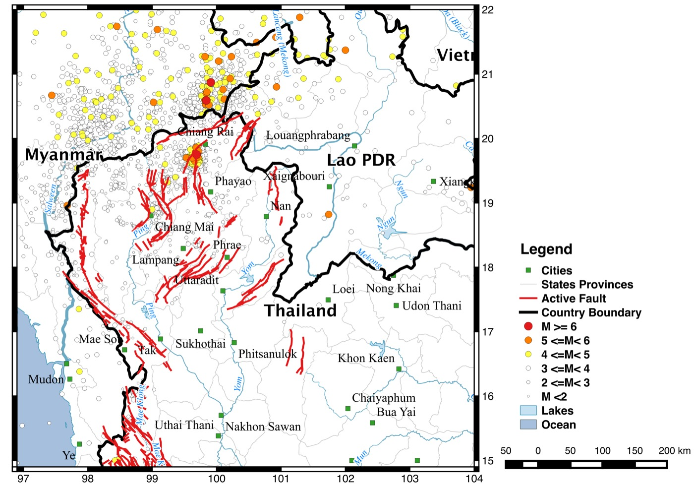

An earthquake catalog for Thailand and neighbouring countries from January 2014 to December 2017, prepared with Dr. Sutthipong Noisagool for the Department of Mineral Resources (DMR), Thailand. We collected event waveforms from the DMR, Thai Meteorological Department (TMD) and Mahidol University networks, relocated the events with HYPO71 and measured local magnitudes from vertical and horizontal components. For events of about M 4 and larger we also inverted regional waveforms for moment tensors.

Unlike existing catalogs, every event carries its location errors and a two-letter HYPO71 quality code (solution quality and station geometry), so users can filter out poorly constrained events.

What is in the catalog
----------------------

- **Local magnitude catalog:** 2,238 events with relocated hypocentres, ML from vertical and horizontal components with standard deviations, RMS residual, horizontal and vertical errors, and quality codes.
- **Moment tensor catalog:** 87 solutions with centroid depth, strike, dip, rake, Mw and waveform fit.
- A final report in Thai (March 2018) describing the data, methods and quality criteria.

The results were presented at the 8th International Conference on Applied Geophysics, Songkhla, in November 2018 ([talk](/talks/2018-11-08-ICAG2018-relocation)), where they received the Best Oral Presentation award.

Data and documents
------------------

- GitHub repository with CSV and PDF catalogs, report, slides and map: [Songkhun/Thailand-Earthquake-Catalog-2014-2017](https://github.com/Songkhun/Thailand-Earthquake-Catalog-2014-2017)
- [Local magnitude catalog (CSV)](https://github.com/Songkhun/Thailand-Earthquake-Catalog-2014-2017/blob/main/catalog/DMR_ML_catalog.csv) · [Moment tensor catalog (CSV)](https://github.com/Songkhun/Thailand-Earthquake-Catalog-2014-2017/blob/main/catalog/DMR_MW_catalog.csv)
- [Final report (Thai, PDF)](https://github.com/Songkhun/Thailand-Earthquake-Catalog-2014-2017/blob/main/docs/DMR_catalog_final_report_TH.pdf)
- [ICAG 2018 slides (PDF)](https://github.com/Songkhun/Thailand-Earthquake-Catalog-2014-2017/blob/main/docs/ICAG2018_relocation_focal_mechanism_slides.pdf)
